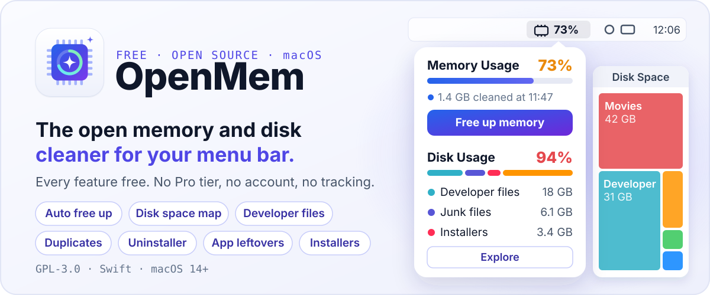

<p align="center">
  
</p>

<p align="center">
  <a href="LICENSE"></a>
  
  
</p>

OpenMem sits in your menu bar and shows how much memory your Mac is using. Click it to free up memory, see which apps use the most, and clean up disk space.

All features are free. There is no Pro version, no trial, no license key, no account, and no telemetry. Automatic cleanup, the duplicate finder, the app uninstaller and large file search are all included, even though cleaner apps often charge for them.

## Features

### Memory

- Live memory use in the menu bar, shown as a percentage or in GB. You can also show the icon only.
- A Free up memory button that tells you how much it freed and when.
- A keyboard shortcut, ⌃⌥⌘M (Control-Option-Command-M), frees memory from any app and shows the result in a notification.
- A list of the five apps using the most memory. Helper processes count toward the app that owns them, the same way Activity Monitor groups them. Hover over an app to quit it.
- Automatic cleanup when memory use passes a threshold you choose, from 50 to 95%. It asks apps to release memory but keeps the disk cache, so the Mac doesn't stall.
- The menu bar number turns orange 10 points below your threshold and red when it reaches it.
- A notification when memory use gets high.

### Disk

- Disk usage at a glance, with a bar split by category.
- Junk files: app caches, the Downloads folder, and the Trash.
- Duplicate files. These are byte-for-byte matches found by size and SHA-256 hash, not by file name. The oldest copy is marked as the original.
- Applications, with the size of each app and an uninstaller that also removes the app's support files (preferences, caches, containers, saved state). App data is counted separately from the apps themselves.
- Large and old files: anything above a size you pick, plus files of 10 MB or more that you haven't opened in over a year.

### General

- Launch at login.
- You enter your password once, not every time. See [Permissions](#permissions).

## Install

You need macOS 14 or later and the Xcode Command Line Tools (`xcode-select --install`).

```sh
git clone https://github.com/medjbilou/openmem.git
cd openmem
./build.sh
mv "OpenMem.app" /Applications/
open "/Applications/OpenMem.app"
```

`build.sh` compiles the Swift sources with `swiftc`, builds the app bundle, and signs it ad hoc. You don't need an Xcode project, and the build downloads nothing.

The memory icon appears in the menu bar. To start the app with your Mac, open Settings (the gear icon) and turn on Launch at login.

## Your files stay safe

The safety rules live in code (`Safety` in `Disk.swift`), so the UI can't skip them.

- Everything goes to the Trash. The app never deletes a file outright, so you can put back anything you change your mind about. The only permanent action is Empty Trash, and it asks you first.
- The app only works inside a fixed list of folders: your user folders (Desktop, Documents, Downloads, Movies, Music, Pictures), `~/Library/Caches`, `/Applications`, and the exact support folders of an app you uninstall. It checks each path again right before moving it, so a symlink can't redirect it somewhere else.
- Apple apps and `com.apple.*` caches never appear in the lists.
- Caches of apps that are running are left alone.
- Git repositories, `node_modules` folders and Python virtualenvs are skipped completely.
- iCloud files that aren't downloaded to your Mac are skipped, so a scan never starts downloading them.
- Downloads, duplicates and large files are never cleaned in bulk. You tick each item yourself, and each row has a button that shows the file in Finder first.

## Permissions

| Permission | Why | When |
| --- | --- | --- |
| Administrator password | Freeing memory runs macOS's own `/usr/sbin/purge`, which needs root | Once (see below) |
| Desktop, Documents, Downloads access | To find duplicates and large files | First disk scan |
| Notifications | High memory alerts and "memory freed" messages | First launch |
| Full Disk Access (optional) | To show the size of the Trash. Without it the row shows `-` | Never asked. Click Allow access next to Uncleaned Trash, then Rescan |

### Why you only enter your password once

The first time you free up memory, the app installs one sudoers rule at `/etc/sudoers.d/openmem`:

```
youruser ALL=(root) NOPASSWD: /usr/sbin/purge, /usr/bin/memory_pressure -S -l warn -s 1
```

This rule allows `purge` and that one exact `memory_pressure` command without a password, and nothing else. `memory_pressure` can't be run with other arguments, so the rule can't be used to fill up memory. If you installed an older version that allowed only `purge`, the app asks for your password once more to update the rule. `visudo` checks the rule before it is installed, so it can't break `sudo`. You can turn it off in Settings at any time, or remove it yourself:

```sh
sudo rm /etc/sudoers.d/openmem
```

## How it works

| Part | Approach |
| --- | --- |
| Memory % | `host_statistics64`, with the same formula as Activity Monitor's "Memory Used" (app memory + wired + compressed) |
| Per-app memory | The `proc_pid_rusage` physical footprint of each process, added up under the app that owns it. The app never starts `ps` or `top`. |
| Free up memory | Three steps. First `sync` writes changed file data to disk. Then `memory_pressure -S -l warn` tells every app that memory is low for one second, so apps release memory and macOS drops purgeable caches. Last, `/usr/sbin/purge` empties the disk cache. Automatic cleanup skips `purge`, because the Mac can stall while the cache fills again. |
| Disk scan | Runs in the background at low priority. One walk of your folders finds both duplicates and large files. Duplicates are compared by size, then by their first 64 KB, then by a full SHA-256. |
| Cost | The menu bar makes one system call every 3 seconds. Per-app memory is only measured while the panel is open. |

### Measured footprint

Measured on an Apple Silicon Mac running macOS 26, with the app idle in the menu bar and its panel closed, sampled every 2 seconds for 60 seconds:

| Metric | OpenMem |
| --- | --- |
| App size | 1.2 MB |
| Memory footprint | 40 MB |
| Average CPU | 0.4% (peak 3.3%) |
| Bundled frameworks | 0 |
| Helper apps or launch agents | 0 |
| Network connections | 0. The app never connects to the internet. |

The code is about 900 lines of Swift in five files:

```
main.swift     menu bar item and panel
Memory.swift   memory stats, per-app memory, purge
Disk.swift     disk scan, duplicate finder, safety rules
Model.swift    state, settings, cleanup actions
Views.swift    SwiftUI interface
```

## Uninstall

1. Quit the app from Settings.
2. Move `OpenMem.app` to the Trash.
3. Remove the password rule: `sudo rm /etc/sudoers.d/openmem`.

## Limits

- Freeing memory flushes caches. It doesn't add memory your Mac doesn't have. macOS manages memory well on its own, so a cleanup helps most when an app has been leaking memory or before you start something heavy.
- The build is signed ad hoc, so macOS asks for folder access again after each rebuild.
- Some apps installed by root-owned installers can't be moved by the app. Drag those to the Trash in Finder.

## Contributing

Issues and pull requests are welcome. The app stays free, so changes that add a paid tier, an account or tracking won't be merged.

## License

[GPL-3.0](LICENSE). You can use, study, change and share the code. If you distribute a modified version, it has to stay open under the same license.
